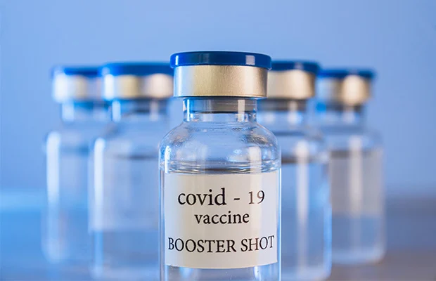

## What is Vaccine Effectiveness?


<ul><li>Measures how well a vaccine performs in real-world settings</li><li>Different from vaccine efficacy measured in trials</li><li>Usually expressed as a percentage reduction in risk</li><li>Important for public health decision making</li></ul>


## Image of vaccine


<p></p>

<p>Covid vaccine</p>

<p>Vaccination remains one of the most effective public health interventions ever developed. Vaccines reduce the risk of infection, severe illness, hospitalisation, and death by helping the immune system recognise and respond to specific pathogens. Large-scale vaccination programmes have contributed to the control or elimination of diseases such as smallpox, polio, and measles in many parts of the world.</p>

<p>During outbreak investigations, vaccination status is often an important variable for understanding patterns of disease transmission. By comparing infection rates among vaccinated and unvaccinated individuals, public health professionals can estimate vaccine effectiveness and assess whether additional interventions may be required. These findings support evidence-based decision making and help guide vaccination policy and practice.</p>


## Youtube


```{=html}
<iframe
  width="900"
  height="506"
  src="https://www.youtube.com/embed/yt3e8Ng0mf0"
  title="YouTube video player"
  frameborder="0"
  allow="accelerometer; autoplay; clipboard-write; encrypted-media; gyroscope; picture-in-picture; web-share"
  referrerpolicy="strict-origin-when-cross-origin"
  allowfullscreen>
</iframe>
```


## Why Does Vaccine Effectiveness Matter?


<ul><li>Supports vaccination policy</li><li>Helps evaluate programme success</li><li>Identifies groups needing additional protection</li><li>Supports outbreak response</li></ul>


## Outbreak Investigation Example


<ul><li>A measles outbreak occurred in a secondary school.</li><li>Investigators compared infection rates among vaccinated and unvaccinated students.</li><li>The results were used to estimate vaccine effectiveness.</li><li>Findings informed public health action.</li></ul>


## Calculating Vaccine Effectiveness


<ul><li>VE = (1 − Relative Risk) × 100</li><li>Relative Risk = attack rate vaccinated ÷ attack rate unvaccinated</li><li>Higher VE indicates greater protection</li><li>Commonly used during outbreak investigations</li></ul>


## Key Messages


<ul><li>Vaccine effectiveness measures real-world protection</li><li>VE supports evidence-based decision making</li><li>Outbreak investigations provide useful VE estimates</li><li>Interpretation requires consideration of study design</li></ul>
